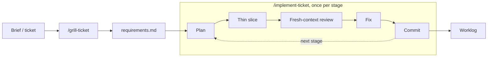

# agentic-dev-workflow

Two Claude Code skills that take a ticket to working, reviewed code. `grill-ticket` checks the
facts itself, asks you only for decisions, and writes a requirements document with stages.
`implement-ticket` builds one stage at a time, has a fresh subagent review it, and commits.

> Evals in progress – results pending.



Brief → /grill-ticket → requirements → /implement-ticket per stage (plan → thin slice →
fresh-context review → fix → commit, repeat) → worklog

## Install

Inside Claude Code:

```text
/plugin marketplace add fuggerstadt1907/agentic-dev-workflow
/plugin install agentic-dev-workflow@agentic-dev-workflow
```

Other ways (copying the skills, one project only) and updating: [install guide](docs/install.md).

## Usage

```text
/grill-ticket #123                          → docs/…/requirements.md (Status: ready)
/implement-ticket docs/…/requirements.md    → stage 1 built, reviewed, committed
/clear
/implement-ticket docs/…/requirements.md    → stage 2 …
```

The short form (`/implement-ticket`) works as long as no other installed skill has the same name.
The namespaced form always works: `/agentic-dev-workflow:grill-ticket`,
`/agentic-dev-workflow:implement-ticket`.

The skills are written in English and work in the language of the project they run in. Each step
is explained on the [workflow page](docs/workflow.md). Templates for a project's
[`CLAUDE.md`](templates/CLAUDE.md) and [`WORKLOG.md`](templates/WORKLOG.md) are in `templates/`.

The goal is that you understand the workflow in 2 minutes and install it in 5. Nobody has measured
that yet.

## Prevention and detection

Some rules in `implement-ticket` prevent defects: a security-relevant stage gets acceptance
criteria written from an attacker's view before building, and every test that asserts something
is absent gets a positive check that what it looks for is really in the input. The review eval does not measure
these rules.

Detection is the fresh-context review with
[`REVIEW.md`](skills/implement-ticket/REVIEW.md). The review eval measures it against a
plain-prompt baseline, using planted defects and clean diffs.

## Why this exists

Coding agents write code fast. They also build on unclear requirements and fill the gaps with
assumptions; the agent that wrote the code reviews it and keeps its blind spots; and nobody
measures whether a prompt or skill helps. These skills come out of a real project. The evals, still
in progress, compare each skill with a plain prompt and report where the skill does not win, too.

This repo is built with its own skills. Every stage is recorded in the
[worklog](docs/WORKLOG.md), and the decisions are in the [requirements](docs/requirements.md).

## Credits

These ideas come from Matt Pocock's [skills](https://github.com/mattpocock/skills):

- [`grilling`](https://github.com/mattpocock/skills/blob/abeeaf95660ba9e8b7c753eb38f441ca707a8823/skills/productivity/grilling/SKILL.md):
  the design tree worked in rounds (`grill-ticket` calls it the decision tree), the frontier of questions whose prerequisites are settled, and
  the split between facts the agent looks up and decisions the user makes. Used in `grill-ticket`
  and, as the split between decisions the agent may settle and decisions for the user, in
  `implement-ticket`.
- [`tdd`](https://github.com/mattpocock/skills/blob/abeeaf95660ba9e8b7c753eb38f441ca707a8823/skills/engineering/tdd/SKILL.md):
  tests at agreed seams, each with a one-line note on what it catches and what it misses, and red
  before green. Used in `implement-ticket`'s plan and build steps.
- [`to-tickets`](https://github.com/mattpocock/skills/blob/abeeaf95660ba9e8b7c753eb38f441ca707a8823/skills/engineering/to-tickets/SKILL.md):
  tracer bullets, narrow slices that cut through every layer. Used in `implement-ticket`'s build
  step.

No text is copied from these skills.

## Contributing

See [CONTRIBUTING.md](CONTRIBUTING.md).

## Licence

[MIT](LICENSE)
