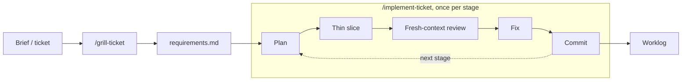

# Workflow

A ticket goes through two skills. `/grill-ticket` turns it into a requirements document: it looks
up the facts itself and asks you only for the decisions. `/implement-ticket` then builds that
document one stage at a time.

Brief → /grill-ticket → requirements → /implement-ticket per stage (plan → thin slice →
fresh-context review → fix → commit, repeat) → worklog

## The steps

**Brief or ticket.** The input can be a ticket file, a GitHub issue or a rough brief.

**`/grill-ticket`.** Subagents read the code, the docs and the schema, so the skill never asks you
for a fact it can look up. The decisions are yours. The skill asks them in rounds, and a question
comes up only once the decisions it depends on are settled. The result is a requirements document
with numbered requirements (R1, R2 …), acceptance criteria, a decision log, open questions and
stages. Its status line says `ready` or `not ready`.

**Requirements document.** This is the mandate for the build. Each stage can be delivered and
tested on its own. An open question blocks only the stages it names.

**`/implement-ticket`, once per stage.** Each run builds one stage, then you `/clear` the context
before the next one.

1. **Plan.** The skill checks the current state of the code, then shows the plan, how each
   acceptance criterion gets verified, and the implementation details it settled itself. It asks
   you once, in one batched round, about everything that changes scope, public output or security
   behaviour. For a security-relevant stage the plan adds acceptance criteria written from an
   attacker's view.
2. **Thin slice.** The build starts with a narrow slice that runs end to end and makes the core
   requirement work. Then come the remaining requirements, with the project's checks run after
   each step.
3. **Fresh-context review.** A subagent that did not write the code reviews the diff with
   [`REVIEW.md`](../skills/implement-ticket/REVIEW.md): does it do what the document asks, and is
   it correct?
4. **Fix.** Real defects get fixed and the checks run again. Findings that are not fixed go into
   the report.
5. **Commit.** One commit per stage, with explicit paths only. The requirements document records
   the stage as done, along with the new decisions.

**Worklog.** If the project has a `WORKLOG.md`, the skill drafts the stage's entry: questions
asked, review findings, what was and was not tested. It leaves the time for you to fill in and
commits the entry only after your OK. See the [template](../templates/WORKLOG.md).

## Prevention and detection

The plan and build steps include rules meant to keep defects out: attacker-view acceptance
criteria for security-relevant stages, and a positive check next to every test that asserts
something is absent. These rules are prevention. The review eval does not measure them.

The fresh-context review with `REVIEW.md` is detection. It is the part the review eval measures
against a plain-prompt baseline.
